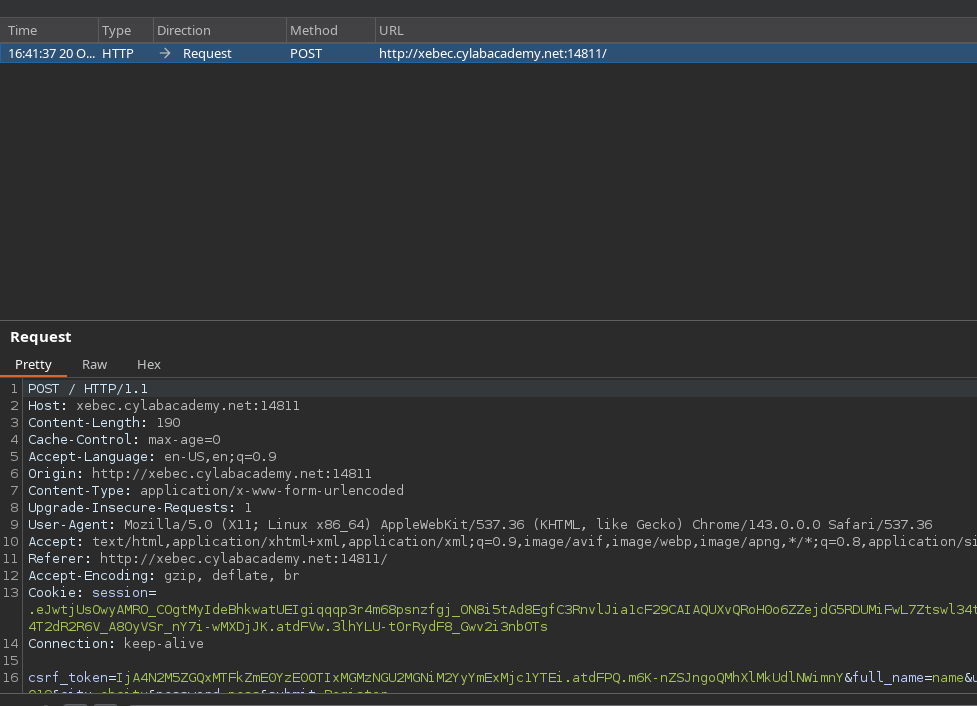
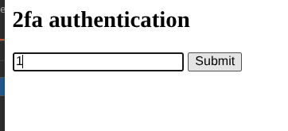
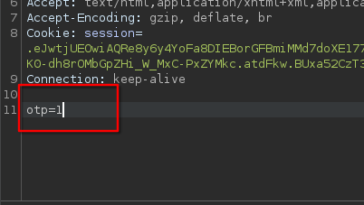

# IntoTheBurp

  <svg xmlns="http://www.w3.org/2000/svg" viewBox="0 0 24 24" width="13" height="13" fill="none" stroke="currentColor" stroke-width="2"><path d="M4 15s1-1 4-1 5 2 8 2 4-1 4-1V3s-1 1-4 1-5-2-8-2-4 1-4 1z"></path><line x1="4" y1="22" x2="4" y2="15"></line></svg> CyLab
  <svg xmlns="http://www.w3.org/2000/svg" viewBox="0 0 24 24" width="13" height="13" fill="none" stroke="currentColor" stroke-width="2"><circle cx="12" cy="12" r="10"></circle><line x1="2" y1="12" x2="22" y2="12"></line></svg> Web Exploitation
  <svg xmlns="http://www.w3.org/2000/svg" viewBox="0 0 24 24" width="13" height="13" fill="none" stroke="currentColor" stroke-width="2"><circle cx="12" cy="12" r="10"></circle><polyline points="12 6 12 12 14 14"></polyline></svg> Easy
  <svg xmlns="http://www.w3.org/2000/svg" viewBox="0 0 24 24" width="13" height="13" fill="none" stroke="currentColor" stroke-width="2"><rect x="3" y="4" width="18" height="18" rx="2" ry="2"></rect><line x1="16" y1="2" x2="16" y2="6"></line><line x1="8" y1="2" x2="8" y2="6"></line><line x1="3" y1="10" x2="21" y2="10"></line></svg> 2026-10-20

!!! tip "Note ⚙"
    This website puts a two-factor prompt between you and the flag. Register an account, then take a close look at the requests your browser is actually sending. Try

1. open burp suite CE and check the requests 

1. open intercept to check the requests 

asking for otp. use random otp to check the requests giving me errors!!

1. removes otp line and sent request . and got the flag

