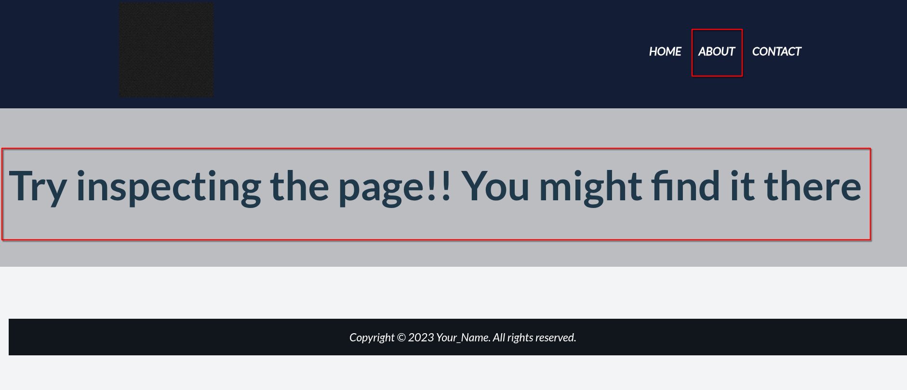
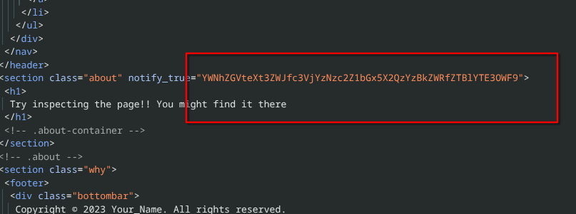
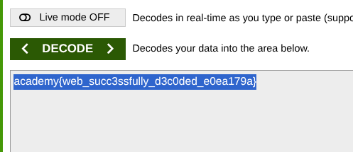

# web-decode

  <svg xmlns="http://www.w3.org/2000/svg" viewBox="0 0 24 24" width="13" height="13" fill="none" stroke="currentColor" stroke-width="2"><path d="M4 15s1-1 4-1 5 2 8 2 4-1 4-1V3s-1 1-4 1-5-2-8-2-4 1-4 1z"></path><line x1="4" y1="22" x2="4" y2="15"></line></svg> CyLab
  <svg xmlns="http://www.w3.org/2000/svg" viewBox="0 0 24 24" width="13" height="13" fill="none" stroke="currentColor" stroke-width="2"><circle cx="12" cy="12" r="10"></circle><line x1="2" y1="12" x2="22" y2="12"></line></svg> Web Exploitation
  <svg xmlns="http://www.w3.org/2000/svg" viewBox="0 0 24 24" width="13" height="13" fill="none" stroke="currentColor" stroke-width="2"><circle cx="12" cy="12" r="10"></circle><polyline points="12 6 12 12 14 14"></polyline></svg> Easy
  <svg xmlns="http://www.w3.org/2000/svg" viewBox="0 0 24 24" width="13" height="13" fill="none" stroke="currentColor" stroke-width="2"><rect x="3" y="4" width="18" height="18" rx="2" ry="2"></rect><line x1="16" y1="2" x2="16" y2="6"></line><line x1="8" y1="2" x2="8" y2="6"></line><line x1="3" y1="10" x2="21" y2="10"></line></svg> 2026-10-20

Web Exploitation `Easy`

!!! tip "Note ⚙"
    Do you know how to use the web inspector? Start searching

A normal website : Inspecting it :

 Nothing found unless the damn dark gif . going to decode it , Nahh nothing works , let me ispect again

whats this. lets decode;

